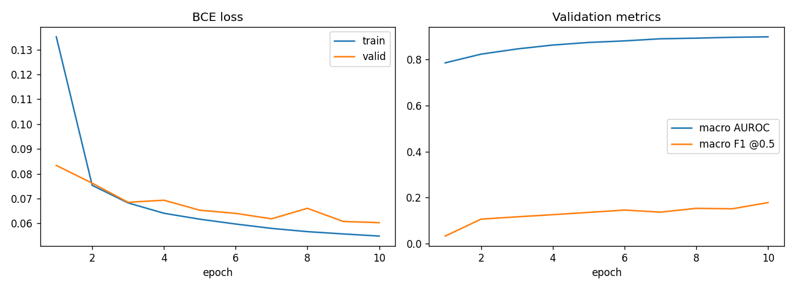

# Multi-label ECG Diagnosis on PTB-XL

A PyTorch model that reads a 10-second, 12-lead ECG plus basic patient metadata and predicts which of **44 diagnostic statements** apply to the recording (for example myocardial infarction subtypes, conduction disturbances and hypertrophy).

I built this project a little over a year ago as one of my first deep-learning projects on medical time-series data, originally as a single Kaggle notebook. This repository is a cleaned-up version for my portfolio: the code is split into a small package with scripts and notebooks, and the evaluation has been redone properly (see [What changed](#what-changed-from-the-original-notebook)). The modelling approach itself is kept as I originally designed it.

> **Note:** This README was written by Claude (Anthropic's AI assistant), which also helped restructure the original notebook into this repository.

**Want to try it?** The trained model is included, so you don't need to download the dataset to use it. See [Try the model](#try-the-model).

---

## The task

[PTB-XL](https://physionet.org/content/ptb-xl/) is a public dataset of **21,837 clinical 12-lead ECGs** (v1.0.1) from 18,885 patients, each 10 s long and annotated by up to two cardiologists with SCP-ECG statements.

* **Input:** the raw ECG at 100 Hz, shape `(1000 time steps × 12 leads)`, plus 8 metadata features.
* **Output:** a probability for each of the 44 *diagnostic* SCP statements.
* **Type:** multi-label classification. One record can have several diagnoses at once (6,411 records have more than one), so each label gets its own sigmoid and the loss is binary cross-entropy.

## Approach

### Data preparation (`ptbxl/data.py`, `prepare_data.py`)
1. **Labels:** a multi-hot vector over all diagnostic statements in `scp_statements.csv` (any statement listed in a record's `scp_codes` counts as positive).
2. **Metadata features:** age, sex, height, weight, infarction stadium 1 and 2 (ordinal-encoded), pacemaker (binary) and extra beats (SVES = 0.5, VES = 1.0, SVES+VES = 1.5). Missing age and weight are filled with 0; implausible or missing heights (< 50 cm) are replaced with the median valid height.
3. **Split:** the official patient-wise stratified folds. Folds 1–8 are used for training, fold 9 for validation and fold 10 for testing. A patient never appears in more than one split.
4. **Scaling:** metadata standardised with a `StandardScaler`, and signals z-normalised per lead. Both use statistics from the training set only.

### Model (`ptbxl/model.py`)

```
ECG (12 x 1000)
  -> Conv1d(32, k=7) + BN + ReLU + MaxPool
  -> Conv1d(64, k=5) + BN + ReLU + MaxPool
  -> Conv1d(128, k=3) + BN + ReLU + GlobalAvgPool  --> 128 ┐
                                                           ├─ concat(160) -> Linear(64) -> ReLU -> Linear(44) -> Sigmoid
metadata (8) -> Linear(32) -> ReLU -> Linear(32)   -->  32 ┘
```

This is a deliberately small two-branch network: a 1D-CNN learns signal features, a small MLP embeds the metadata, and the two are fused before the classifier.

### Training (`ptbxl/training.py`, `train.py`)
BCE loss, Adam (lr = 1e-3), batch size 64, 10 epochs. The checkpoint with the lowest validation loss is kept.

### Evaluation (`ptbxl/metrics.py`, `evaluate.py`)
The selected checkpoint is evaluated **once** on the test fold:

| Metric | Why |
|---|---|
| **Macro AUROC** (main metric) | Threshold-free ranking quality, every label weighted equally. The standard metric in the PTB-XL benchmark ([Strodthoff et al., 2020](https://arxiv.org/abs/2004.13701)). |
| Micro AUROC | Pooled over all label cells. |
| Macro / micro average precision | PR-curve area; much stricter on rare labels. |
| Macro / micro / sample-wise F1 @ 0.5 | Quality of the actual yes/no decisions. |
| Subset accuracy | Whole label vector exactly right. |
| Hamming loss | Fraction of wrong label cells. |

Per-label AUROC, AP, precision, recall and F1 are also written to `results/per_label_test.csv`.

## Results

Test fold 10 (2,203 records, never seen during training or model selection), using the epoch-10 checkpoint. The run took 10 epochs on CPU with seed 42.

| Metric | Test | Validation |
|---|---|---|
| **Macro AUROC** | **0.910** | 0.899 |
| Micro AUROC | 0.968 | 0.968 |
| Macro average precision | 0.271 | 0.294 |
| Micro average precision | 0.704 | 0.697 |
| Micro F1 @ 0.5 | 0.644 | 0.636 |
| Macro F1 @ 0.5 | 0.173 | 0.179 |
| Subset (exact-match) accuracy | 0.524 | 0.509 |
| Hamming loss | 0.020 | 0.020 |
| *Label-wise accuracy (old metric)* | *0.981* | *0.980* |
| *...same metric, predicting all zeros* | *0.968* | *0.968* |



**Reading the numbers**

* **Ranking is good:** 0.91 macro AUROC. The strongest models in the PTB-XL benchmark (much deeper networks such as xresnet1d101 and InceptionTime) reach about 0.93 on this "diagnostic" task, so this small 3-layer CNN gets surprisingly close.
* **Common diagnoses are detected well at the default threshold.** For example, F1 is 0.85 for NORM, 0.76 for ASMI, 0.75 for LAFB, 0.83 for CRBBB and 0.87 for CLBBB.
* **Rare diagnoses are almost never predicted at 0.5.** This is why macro F1 (0.17) and macro AP (0.27) are low even though their AUROCs are often high: the model ranks them sensibly but rarely pushes their probability above 0.5. Per-label thresholds and class weighting would be the obvious next steps (see Known limitations).
* **The old metric hides all of this.** The original 98.1% "accuracy" is only 1.2 points above a model that predicts nothing at all.
* **Training had not converged.** Validation loss was still improving at epoch 10, so a longer run would probably do somewhat better. The 10-epoch setup is kept to match the original.

Full per-label results are in [`results/per_label_test.csv`](results/per_label_test.csv).

## What changed from the original notebook

The model design, features and training setup are unchanged. The following were fixed:

1. **Evaluation metrics (main fix).** The original reported `(preds == labels).sum() / labels.numel()` and got about 98% "accuracy". Because about 97% of the label matrix is zero, predicting "no diagnosis" for every record already gets about 97%, so the number said almost nothing. It has been replaced with the metrics above, and the old number is still printed next to its all-negative baseline for comparison.
2. **Test set used during training.** The original evaluated the test set every epoch alongside validation. The test set is now used only once, after model selection.
3. **ECG normalisation axis.** The code was commented as per-lead normalisation with shape `(12,)`, but on data of shape `(N, 1000, 12)` it used `axis=(0, 2)`, which gave per-*timestep* statistics of shape `(1000,)`. It now uses `axis=(0, 1)` as intended.
4. **Height feature.** Height was cleaned and median-imputed but never added to the feature matrix. It is now included, so there are 8 metadata features instead of 7.
5. **Smaller things.** The epoch loss is averaged per sample instead of per batch; seeds are fixed for reproducibility; `fillna(..., inplace=True)` on columns was replaced with assignments, because that pattern silently does nothing under pandas copy-on-write; the checkpoint stores label names and model dimensions so evaluation can rebuild the model on its own.

The original notebook is kept unchanged in [`notebooks/archive/PTB_XL_original.ipynb`](notebooks/archive/PTB_XL_original.ipynb) for reference. Note that its printed accuracies are the misleading metric described in point 1.

## Known limitations

These are left as they were in the original design:

* **Age:** PTB-XL encodes ages above 89 as `300` for privacy reasons, and these values are not clipped. Missing age and weight are filled with `0` rather than with a typical value.
* **Height imputation:** the median height is computed over the whole dataset rather than over the training split only (a very minor leak).
* **Label definition:** a statement counts as positive regardless of its likelihood value in `scp_codes`.
* **Fixed threshold:** F1 scores use a single threshold of 0.5 for all labels. Per-label thresholds tuned on validation would give higher F1 for rare labels.
* **Class imbalance** is not addressed (no loss weighting or resampling), so rare labels are often never predicted at 0.5.
* **Model size:** the model is small, and only the 100 Hz version of the signals is used.

## Try the model

> ⚠️ This is a portfolio project, **not a medical device**. Do not use its output for any clinical decision.

The trained weights (`model/`, about 220 KB) and 8 example ECGs from the test set (`samples/`) are included in the repo:

```bash
git clone https://github.com/Fuzzonaut/ECG_Classification.git && cd ECG_Classification
pip install torch wfdb pandas scikit-learn scipy matplotlib gradio
```

**Web demo.** Pick a sample or upload your own ECG, then see the 12-lead plot and the top predictions:

```bash
python app.py        # opens http://127.0.0.1:7860
```

**Command line:**

```bash
python predict.py --list-samples
python predict.py samples/00180_lr --age 81 --sex female
python predict.py my_ecg.csv --fs 500 --age 60 --sex female     # CSV: 12 columns (I, II, III, aVR, aVL, aVF, V1–V6), ≥ 10 s
```

**From Python:**

```python
from ptbxl.inference import ECGPredictor

predictor = ECGPredictor("model")
signal = predictor.read_record("samples/00180_lr")   # or predictor.read_csv("ecg.csv", fs=500)
for r in predictor.predict(signal, age=81, sex="female")[:5]:
    print(f"{r['code']:<6} {r['probability']:.1%}  {r['description']}")
```

Inputs can be any sampling rate; they are resampled to 100 Hz, and the first 10 seconds are used. Missing patient info is filled the same way as during training.

**Host it for free.** Create a [Hugging Face Space](https://huggingface.co/new-space) with the *Gradio* SDK and upload `app.py`, `requirements.txt`, `ptbxl/`, `model/` and `samples/`. The Space builds itself and gives you a public link.

To regenerate `model/` and `samples/` after retraining, run `python export_model.py --data-dir data/ptb-xl`.

## Repository structure

```
├── ptbxl/                       # importable package
│   ├── data.py                  # loading, labels, features, split, scaling, caching
│   ├── model.py                 # ECG1DCNN
│   ├── training.py              # training loop, prediction, checkpoint loading
│   ├── metrics.py               # multi-label evaluation metrics
│   └── inference.py             # ECGPredictor: run the trained model on a new ECG
├── prepare_data.py              # step 1: raw PTB-XL -> data/processed/data.npz (+ preprocessing.json)
├── train.py                     # step 2: train, save best checkpoint + curves
├── evaluate.py                  # step 3: test-set metrics -> results/
├── export_model.py              # step 4: package weights + stats + sample ECGs for sharing
├── predict.py                   # CLI: predict one ECG
├── app.py                       # Gradio web demo
├── model/                       # trained weights, preprocessing stats, label descriptions
├── samples/                     # 8 test-set ECGs (PTB-XL, CC BY 4.0) for the demo
├── notebooks/
│   ├── 01_data_exploration.ipynb
│   ├── 02_training_and_evaluation.ipynb
│   └── archive/PTB_XL_original.ipynb
├── requirements.txt
└── README.md
```

## How to run

```bash
pip install -r requirements.txt

# 1. Download PTB-XL (~3 GB) into data/ptb-xl
#    https://physionet.org/content/ptb-xl/  (or the Kaggle mirror)
wget -r -N -c -np -nH --cut-dirs=3 -P data/ptb-xl https://physionet.org/files/ptb-xl/1.0.3/
#    data/ptb-xl should now contain ptbxl_database.csv, scp_statements.csv and records100/

# 2. Prepare -> train -> evaluate
python prepare_data.py --data-dir data/ptb-xl      # writes data/processed/data.npz (~1 GB)
python train.py                                    # writes checkpoints/ and results/history.json, training_curves.png
python evaluate.py                                 # writes results/metrics_test.json, per_label_test.csv
python export_model.py --data-dir data/ptb-xl      # optional: refresh model/ and samples/
```

All scripts take `--help`. To use the notebooks instead, run `prepare_data.py` first, then open `notebooks/02_training_and_evaluation.ipynb`.

The original work was done with PTB-XL v1.0.1 on Kaggle. v1.0.3 on PhysioNet has the same file layout and works the same way.

## Acknowledgements

* Wagner, P., Strodthoff, N., et al. *PTB-XL, a large publicly available electrocardiography dataset.* Scientific Data 7, 154 (2020).
* Strodthoff, N., Wagner, P., Schaeffter, T., Samek, W. *Deep Learning for ECG Analysis: Benchmarks and Insights from PTB-XL.* IEEE JBHI (2021).
* Data via [PhysioNet](https://physionet.org/content/ptb-xl/) (Goldberger et al., 2000).
